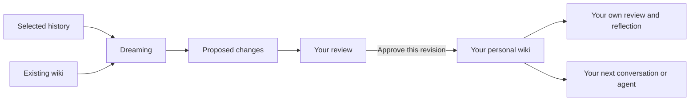

<div align="center">

# Dreaming Skill

### Turn conversations with your agents into a personal memory wiki you control.

An Agent Skill that reviews conversation history, checks existing memories, and organizes important decisions, feedback, and evolving understanding into a personal Markdown wiki.<br />
See what was decided, what changed after your feedback, and what becomes memory. Review it yourself, then reuse it in your next chat or with your next agent.

**Agents change. Your memory should stay with you.**

**Markdown Wiki · Evidence-backed · Review before merge**

[**English**](README.md) · [简体中文](README_CN.md)

[Quick Start](#quick-start) · [What to Remember](#what-to-remember) · [How It Works](#how-it-works) · [Switching Agents](#switching-agents) · [Documentation](#documentation)

</div>

---

## Understand your collaboration. Decide what becomes memory.

Important choices, an agent's suggestions, and your corrections can be scattered across conversations. It can be difficult to reconstruct why a direction was chosen, what changed after your feedback, and which conclusions are established or still uncertain.

Dreaming organizes the valuable parts of that collaboration alongside their evidence. **You can revisit important decisions, check how a memory was formed, correct misunderstandings, and decide what deserves to stay.** The wiki gives you a way to reflect on your own experience, as well as context a future agent can read.

You keep the files in a directory you choose, where you can read, revise, back up, and move them independently of the agent. Over time, reviewed experience becomes a personal data asset you control. When you start a new chat or switch agents, share the relevant pages instead of reconstructing all that context from scratch.

| What you keep | Why it matters |
| --- | --- |
| **Your decisions and their reasons** | Revisit why a choice was made and the conditions that made it appropriate. |
| **Your feedback and ways of working** | See how feedback changed the approach, and carry useful lessons into future collaboration. |
| **Your goals and evolving views** | Keep what is established separate from what you are still exploring. |
| **Your evidence and control** | Trace important memories to their sources, correct misunderstandings, and approve changes before they enter the wiki. |

The asset is the curated understanding you can reuse—not the number of conversations you have stored.

## Quick Start

**Requirements:** Python 3.10+ and an agent that can load `SKILL.md`, read selected history, and run local Python helpers. The agent provides the reasoning; the helpers use the Python standard library, with no additional packages or separate model API key required by this skill.

### 1. Make the skill available to your agent

Place this repository in your host's skill discovery directory. For a Codex setup using `~/.codex/skills/`:

```sh
git clone https://github.com/wjw66/dreaming-skill.git ~/.codex/skills/dreaming-skill
```

The skill folder contains `SKILL.md`, `scripts/`, `references/`, and `agents/`. Other hosts can use the same folder structure where they support it; history access is configured separately.

### 2. Ask it to dream

Invoke `$dreaming-skill` in a session where the skill is available, or make an explicit request:

```text
Use Dreaming to build my personal memory wiki at ~/personal-memory.
For the first run, review the conversation exports in ~/agent-history.
Keep decisions, tradeoffs, feedback, and ideas that will help future work.
Show me the proposed changes before merging anything.
```

You choose **where memory lives** and **which conversations to include**. You can select available local history, a starting date, or particular exports. Later runs reuse that configuration and analyze new content in the selected conversations, including newly appended turns in older sessions.

### 3. Review what becomes memory

The agent presents the candidate wiki, source coverage, important changes, uncertainties, and a revision-bound review with a full diff. You can approve it, request edits, defer, or reject it. **Analysis is permission to prepare a proposal; merging requires your approval of that specific version.**

Keep your memory directory separate from this source repository. See [commands and input formats](references/cli.md) for manual setup and supported exports.

## What to Remember

Dreaming starts with a question: **What future judgment or action would be better because this was remembered?**

It prioritizes meaningful choices, the reasons behind them, feedback that changes the next attempt, durable goals, and useful constraints. A temporary status update or an isolated command result normally stays in the original history.

| An interaction | Memory worth carrying forward | Future use |
| --- | --- | --- |
| A learning document is either too shallow or too hard to follow. | Preserve technical depth while improving explanations; retain the task context. | Explain the next difficult topic clearly without stripping out its mechanism. |
| A fixed template forces important content out. | Content should guide the layout; templates provide a starting point. | Adapt the format when it interferes with the actual goal. |
| Repeated iterations do not produce a noticeable improvement. | Preserve the feedback and the decision to reconsider scope. | Reassess the direction before investing in another round of changes. |
| A proposed idea is followed by “I may be wrong—challenge this.” | Keep the idea provisional, together with the request to test it. | Continue the reasoning without treating a question as a settled belief. |

Concrete details still matter when they govern future action. Scope, conditions, and important prohibitions belong with the memory. A one-task preference should keep its scope; a tentative thought should keep its uncertainty.

## How It Works



1. **Read the increment.** Capture a source boundary and read new messages and completed tool exchanges across selected conversations. Previously analyzed history is not replayed just because a session receives another turn.
2. **Check the evidence.** Compare new information with existing memory. Distinguish user statements, supplied materials, tool observations, and agent inference. Revisit contradictions and preserve unresolved differences.
3. **Select for lasting value.** Keep what can improve future understanding or action. Preserve the user's reasons and useful conditions; explain why each retained candidate deserves a place.
4. **Organize around the person.** Put personal context, goals, views, and collaboration feedback first. Add practices, project context, or event pages where they help explain a meaningful choice.
5. **Review, then merge.** Seal the proposal as a specific revision. Approval applies to that revision; changed content needs a new review.

The host agent interprets and writes the memories. Python helpers handle source checkpoints, evidence references, exact file edits, review integrity, and merging. Running the scanner alone does not produce a finished wiki, and structural validation does not prove a memory is true or useful.

## Inside Your Memory Wiki

```text
personal-memory/
├── index.md                 # Start with the person
├── current.md               # Meaningful focus and open questions
├── semantic/
│   ├── personal/            # Background, goals, views, collaboration
│   ├── practices/           # Reusable approaches and lessons
│   └── projects/            # Project context worth carrying forward
├── events/                  # Selected decisions and feedback over time
├── evidence/                # Necessary excerpts and source references
└── .dreaming/               # Private snapshots, checkpoints, drafts, reviews
```

The layers serve different purposes: **evidence supports a claim; events explain how it changed; semantic pages hold the useful understanding**. A memory does not need a page in every layer. Categories and event pages are created when they add value.

These are ordinary Markdown files with relative links. You can inspect and edit the wiki with your own tools and keep reviewed pages under your own backup or version-control process. `.dreaming/` can contain raw conversations and private workflow records; keep it private and out of published repositories.

## Switching Agents

**The agent is a reader of your memory. The files remain yours.**

1. Keep the wiki in a directory you control, independent of the agent installation.
2. Give your next agent access to the pages you want it to use.
3. Tell it to begin at `index.md`, read relevant pages on demand, and follow evidence when a claim needs checking.
4. If it will also maintain the wiki, make this skill available and explicitly select the history it may process.

For example:

```text
My personal memory wiki is at ~/personal-memory.
Read index.md first, then the pages relevant to this task.
Respect their scope and uncertainty. Check the linked evidence when needed.
```

Moving the wiki preserves the readable memory artifact. **Importing a new host's history and automatically loading memory into its context are separate integration steps.** This MVP does not inject context automatically.

When moving machines, preserve supporting evidence and any private snapshots you need for traceability. Configure history access on the destination; checkpoints depend on source identities and paths, so they are not a universal cross-machine migration format. Your own backups remain important.

## Current Support

| Area | Available today |
| --- | --- |
| Native history adapter | Supported local Codex session JSONL in active and archived session directories. Other application history stores require an export. |
| Explicit inputs | Supported JSONL, normalized JSON, and append-only UTF-8 Markdown or text. Text-only exports do not establish complete tool evidence. |
| Memory reuse | Any agent with access to the files and the ability to read Markdown can be directed to use the wiki. Native history integration varies by host. |
| Invocation | An explicit request. A user-configured scheduled invocation may prepare a proposal; it still requires approval before merging. |
| Input assumptions | Append-only history. Historical edits and deletions are outside the current reconciliation scope; non-text attachments are reported, not interpreted. |
| Model execution | Uses your host agent's reasoning. The helpers run locally; model processing and data handling follow your chosen host. |

This is a local implementation inspired by Dreaming, not a client for Anthropic's hosted Dreams API. Review source coverage and missing inputs for each run; do not assume every conversation in an application is accessible.

## Documentation

- [Skill instructions](SKILL.md) — invocation, evidence checks, organization, and approval.
- [Wiki design](references/wiki-design.md) — long-term value, memory layers, and person-first navigation.
- [CLI and input formats](references/cli.md) — setup, progress, revisions, merging, and recovery.
- [Behavioral evaluation](references/evaluation.md) — check whether memories support better future work.

For development:

```sh
python3 -m unittest discover -s tests -v
python3 scripts/dream.py --help
```

Tests run on synthetic inputs in isolated temporary wikis. They verify bookkeeping and review boundaries. Evaluate memory selection and usefulness separately on representative tasks.

## Inspiration & Contributions

Inspired by Anthropic's [components of agent memory](https://www.anthropic.com/research/components-of-agent-memory) and [Dreaming cookbook](https://platform.claude.com/cookbook/managed-agents-cma-dreaming-with-a-dynamic-workflow). [TencentDB Agent Memory](https://github.com/TencentCloud/TencentDB-Agent-Memory) also provides a useful perspective on treating accumulated experience as portable memory assets.

Contributions are welcome, especially history adapters, realistic memory-use evaluations, and examples of when a remembered decision helps—or gets in the way. Share issues and proposals through [GitHub Issues](https://github.com/wjw66/dreaming-skill/issues), using synthetic or redacted examples.

---

<div align="center">

**Choose your agent. Keep your memory.**

</div>
