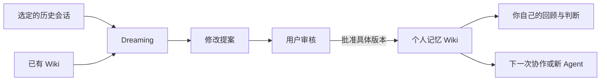

<div align="center">

# Dreaming Skill

### 把与 Agent 的对话，整理成由你掌控的个人记忆 Wiki。

一个回顾历史会话、核对已有记忆，把重要决策、反馈与认识变化整理为个人 Markdown Wiki 的 Agent Skill。<br />
让你看清讨论中的重要选择、反馈如何改变做法，以及哪些内容成为记忆；你可以自己回顾、核对和修正，也能交给下一位 Agent 继续使用。

**Agent 会换，记忆不该跟着消失。**

**Markdown Wiki · 依据可回查 · 确认后合并**

[English](README.md) · [**简体中文**](README_CN.md)

[快速开始](#快速开始) · [什么值得记住](#什么值得记住) · [工作机制](#工作机制) · [更换 Agent](#更换-agent) · [文档入口](#文档入口)

</div>

---

## 看清协作中留下了什么，决定哪些值得记住

重要选择、Agent 的建议和你的纠正，可能散落在不同会话中。之后再回看，很难迅速弄清：为什么选择这条路线、反馈改变了什么、哪些结论已经确认、哪些仍不确定。

Dreaming 把协作中有价值的部分与依据一起整理。**你可以回顾重要决策，核对记忆是怎样形成的，修正误解，并决定哪些内容值得留下。** 这份 Wiki 既供你理解和复盘自己的经历，也能为后续 Agent 提供协作背景。

文件保存在你指定的目录中，可以自己阅读、修改、备份和迁移，独立于 Agent 的安装与更换。经过审核的经验，逐步成为你掌控的个人数据资产。下次开新对话或更换 Agent 时，可以把相关页面交给它参考，减少从头还原背景的负担。

| 你留下的资产 | 长期价值 |
| --- | --- |
| **决策及其理由** | 回看为什么这样选，以及这个选择成立的条件。 |
| **反馈与协作方式** | 看清反馈如何改变做法，把有用的经验带入后续协作。 |
| **目标与变化中的观点** | 分清已经确认的认识和仍在探索的想法。 |
| **依据与控制权** | 重要记忆能回查来源、纠正误解，写入 Wiki 前由你确认。 |

真正的资产，是可以复用的理解，而不是存下了多少次对话。

## 快速开始

**运行要求：**Python 3.10+，以及能够加载 `SKILL.md`、读取指定历史并运行本地 Python 辅助脚本的 Agent。分析与整理使用宿主 Agent 的推理能力；辅助脚本只依赖 Python 标准库，这个 Skill 本身不需要额外安装依赖或单独配置模型 API 密钥。

### 1. 让 Agent 能发现这个 Skill

把仓库放进宿主的技能目录。以使用 `~/.codex/skills/` 的 Codex 配置为例：

```sh
git clone https://github.com/wjw66/dreaming-skill.git ~/.codex/skills/dreaming-skill
```

技能目录包含 `SKILL.md`、`scripts/`、`references/` 和 `agents/`。其他宿主可以在支持这种结构的技能目录中使用；历史会话的访问方式需要另行配置。

### 2. 发起一次 Dreaming

在能够发现该技能的会话里调用 `$dreaming-skill`，也可以直接明确提出要求：

```text
使用 Dreaming，把我的个人记忆 Wiki 放在 ~/personal-memory。
第一次先分析 ~/agent-history 里的会话导出文件。
保留对以后有用的决策、权衡、反馈和思考。
先给我看修改提案，确认后再合并。
```

你来决定**记忆放在哪里**，以及**第一次分析哪些会话**。可以指定可用的本地历史、起始日期或导出文件。后续调用沿用这份配置，分析所选会话的新内容，包括旧会话中刚追加的轮次。

### 3. 确认哪些内容成为记忆

Agent 会展示候选 Wiki、实际覆盖范围、重要修改、不确定项，以及绑定具体版本的审核和完整差异。你可以批准、要求调整、暂缓或拒绝。**允许分析，只代表允许准备提案；合并需要你确认那个具体版本。**

请把个人记忆目录与本项目的源码目录分开。手动配置和导出格式见[命令与输入说明](references/cli.md)。

## 什么值得记住

Dreaming 首先问：**记住这件事，会让以后哪一次判断或行动变得更好？**

优先保留有意义的选择、选择背后的理由、能改变下次做法的反馈、长期目标和重要约束。普通进度更新、孤立的命令结果，通常留在原始历史里即可。

| 一次交互 | 值得带走的记忆 | 以后怎样使用 |
| --- | --- | --- |
| 学习文档太浅，或读起来太难懂。 | 改善解释方式，同时保留必要技术深度及任务语境。 | 下一次讲复杂问题时，既清楚，也讲明白机制。 |
| 固定模板装不下重要内容。 | 内容决定布局，模板提供起点。 | 形式妨碍目标时调整页面，而不是丢掉必要信息。 |
| 多轮迭代仍没有明显改善。 | 保留当时的反馈，以及重新判断范围的决定。 | 继续投入之前，先检查方向与效果。 |
| 提出观点后，又说“我可能不对，你先纠正”。 | 连同检验请求一起保留这个暂定想法。 | 继续推理时，避免把提问写成已经确定的认识。 |

具体细节如果会影响未来行动，同样值得保留。适用范围、成立条件和重要禁止项应与记忆一起留下。一次任务里的偏好保留其边界；尚不确定的想法保留其不确定性。

## 工作机制



1. **读取增量。**固定本次来源边界，读取所选会话中的新消息和已结束的工具交互。旧会话多了一轮，不代表要从头重新分析。
2. **核对依据。**对照新信息与已有记忆，区分用户陈述、提供的材料、工具观察和 Agent 推断；检查矛盾，保留无法解释的分歧。
3. **筛选长期价值。**留下能帮助以后理解和行动的内容，保留用户的理由和必要条件，并说明为什么值得记。
4. **围绕人组织。**把个人背景、目标、观点与协作反馈放在前面；实践、项目背景和事件页用于解释重要选择，按需建立。
5. **审核后合并。**提案封存为一个具体版本，批准只对这个版本生效；内容改动后重新审核。

宿主 Agent 负责理解与撰写；Python 辅助脚本负责来源进度、证据引用、精确修改、审核完整性和合并。单独运行扫描命令不会生成完整 Wiki，结构校验通过也不代表记忆一定真实或有用。

## 你的记忆 Wiki

```text
personal-memory/
├── index.md                 # 从了解这个人开始
├── current.md               # 有意义的关注与未决问题
├── semantic/
│   ├── personal/            # 背景、目标、观点与协作方式
│   ├── practices/           # 可复用的做法与经验
│   └── projects/            # 值得长期保留的项目背景
├── events/                  # 精选的决策变化与反馈经历
├── evidence/                # 必要原话与来源定位
└── .dreaming/               # 私有快照、进度、候选与审核记录
```

各层各有用途：**证据说明依据，事件解释变化，语义页保存可复用的理解。** 同一条记忆不必在每层各写一份；分类和事件页在有价值时才创建。

这些是普通 Markdown 文件，使用相对链接。你可以用自己的工具查看、修改，并按自己的方式备份或管理已审核的页面版本。`.dreaming/` 可能含有原始会话和私有运行记录，应保持私有，不要放进公开仓库。

## 更换 Agent

**Agent 负责读取记忆，记忆文件由你持有。**

1. 把 Wiki 保存在自己掌控的目录，与 Agent 安装目录分开。
2. 让下一位 Agent 能访问你希望它使用的页面。
3. 告诉它从 `index.md` 开始，按任务读取相关页面，需要核对时沿链接查看依据。
4. 如果希望它继续维护 Wiki，再提供这个 Skill，并明确允许处理哪些历史。

例如：

```text
我的个人记忆 Wiki 在 ~/personal-memory。
先读 index.md，再读与本次任务相关的页面。
保留其中的适用范围和不确定性，需要时回查链接里的依据。
```

迁移 Wiki，可以保留这份可阅读的记忆资产。**导入新宿主的历史，以及让记忆自动进入其上下文，是另外的接入步骤。** 当前 MVP 不自动注入上下文。

跨机器迁移时，请保留需要的证据及私有快照，以便继续追溯。目标机器的历史访问要重新配置；进度记录依赖来源身份和路径，不是通用的跨机器迁移格式。自己的备份仍然重要。

## 当前支持范围

| 方面 | 当前能力 |
| --- | --- |
| 原生历史适配 | 支持 Codex 活跃及归档会话目录中的本地 JSONL 格式。其他应用历史存储需要先导出。 |
| 显式输入 | 支持约定格式的 JSONL、规范化 JSON，以及只追加的 UTF-8 Markdown 或文本。纯文本导出不能证明工具记录完整。 |
| 记忆复用 | 能访问文件并阅读 Markdown 的 Agent，可以被指示使用 Wiki。原生历史接入能力因宿主而异。 |
| 触发方式 | 用户明确调用。用户自行配置的定时调用可以生成提案，合并仍需单独确认。 |
| 输入约定 | 面向追加式历史；历史消息修改、删除不在当前核对范围内。非文本附件会报告遗漏，不解释其内容。 |
| 模型运行 | 使用宿主 Agent 的推理能力。辅助脚本在本地运行，模型处理和数据流转遵循所选宿主。 |

这是受 Dreaming 启发的本地实现，不是 Anthropic 托管 Dreams API 的客户端。每次运行都应查看实际覆盖范围和缺失来源，不能假设应用里的所有会话都可以访问。

## 文档入口

- [Skill 指令](SKILL.md)：触发、证据核对、组织与审批。
- [Wiki 设计](references/wiki-design.md)：长期价值、记忆分层与人物优先导航。
- [命令与输入格式](references/cli.md)：初始化、进度、修订、合并及恢复。
- [行为评估](references/evaluation.md)：检查记忆是否帮助后续工作。

开发验证：

```sh
python3 -m unittest discover -s tests -v
python3 scripts/dream.py --help
```

测试使用模拟输入和独立的临时 Wiki，验证流程记录与审核边界。记忆筛选是否恰当、实际是否有用，需要结合代表性任务另行评估。

## 灵感与贡献

本项目受 Anthropic 的[记忆组件研究](https://www.anthropic.com/research/components-of-agent-memory)和[Dreaming 工作流示例](https://platform.claude.com/cookbook/managed-agents-cma-dreaming-with-a-dynamic-workflow)启发。[TencentDB Agent Memory](https://github.com/TencentCloud/TencentDB-Agent-Memory)也为“将积累的经验视为可迁移的记忆资产”提供了有价值的参考。

欢迎贡献历史适配器、真实任务评估，以及记忆如何帮助判断或造成干扰的案例。可以在 [GitHub Issues](https://github.com/wjw66/dreaming-skill/issues) 提出问题与建议，使用模拟或脱敏的示例。

---

<div align="center">

**选择适合你的 Agent，保留属于你的记忆。**

</div>
